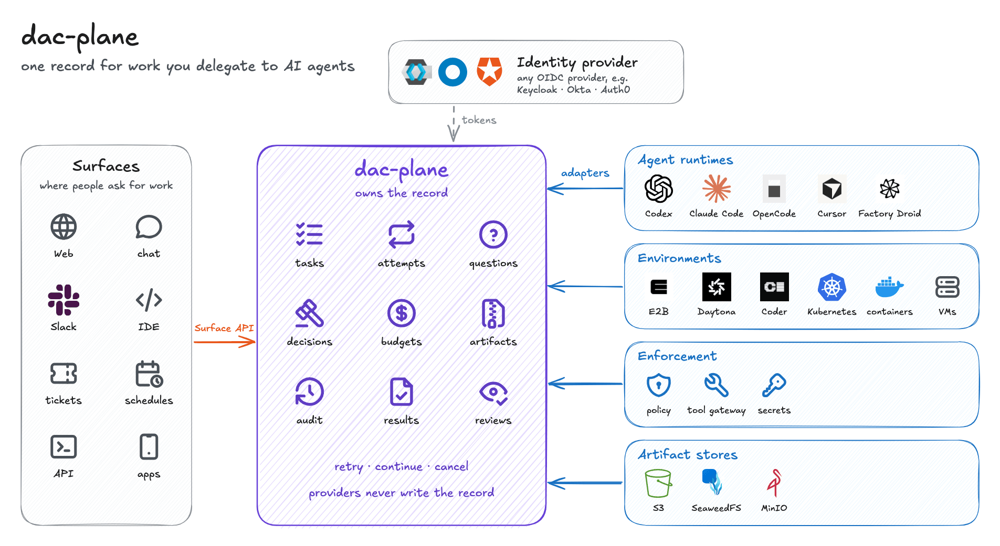
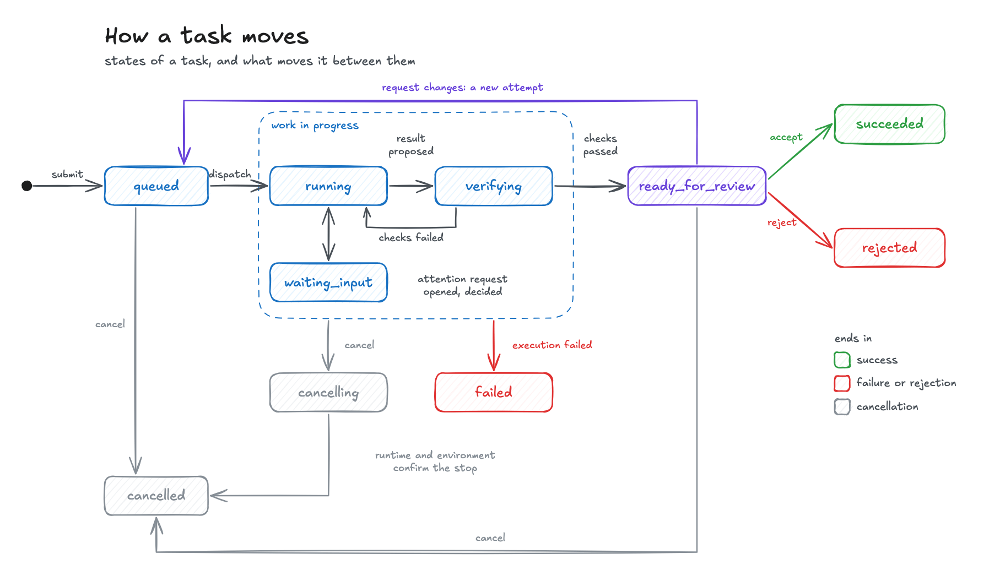

I've written about the same problem twice this year. In June, after testing coding agents in cloud sandboxes, I wrote that [a sandbox is only where the agent runs](/docs/blog/Agents-at-scale) and ended with an open question: can the open ecosystem get the reliability of the vendor products while letting you choose your own model, sandbox and agent? In September, I wrote that [the chat app is the last thing that matters](/docs/blog/the-control-plane-isnt-a-chat-app) and that the layer worth building is the one underneath, which I called the control plane.

When I wrote those posts, I believed somebody was already building that layer in the open and that I would end up using theirs. In October I went looking for it properly, found a gap, and started building into it. The project is called [dac-plane](https://github.com/dac-plane/dac-plane), and it's open source.

This post is to argue that every company serious about agents will end up running its own team of them, inside its own product, with its own tools, and that the foundation for doing that should be open. I'll cover what a team of agents looks like, what it takes to build one today, and what dac-plane lets you do.

## what a team of agents looks like

xAI's Grok bot team is the clearest picture I've seen. Each bot has a name and a job. It gets its own computer in the cloud, its own memory and its own tools. You message it like a colleague, it keeps working while your laptop is closed, and it comes back when it has progress to show or a decision it needs from you. Cursor, Codex and Devin sell the same shape for coding.

Now imagine that inside your own company. You have a reviewer agent that knows your code standards, a migration agent that handles dependency upgrades, and a triage agent that works the support queue. People hand them work from the product your team already uses. The agents run on whichever runtime suits the job, use your company's systems, ask a person when they need a decision, and leave a clear trail of what they did.

I think this is where most companies are heading. The question I care about is how hard it is to build.

## what it takes to build one today

I found out by building one. Earlier this year I made [Foreman](https://github.com/AssahBismarkabah/Foreman), which takes a task from Slack or Discord, runs an agent in a cloud sandbox and reports back to the channel. Calling the agent was the easy part. The work was everything around it:

1. Turning a message into a task with an owner and a state.
2. Starting the right agent in the right sandbox, and knowing when either one died.
3. Getting the agent's question to the right person and the answer back to the exact place it was waiting.
4. Setting a spending limit and enforcing it before the money is gone.
5. Cancelling a task and being sure it really stopped.
6. Keeping the files it produced, and letting someone accept the result or send it back.
7. Being able to say afterwards what happened, step by step.

None of that is specific to Slack or to one agent. It's the same plumbing for a support tool, a code review tool or an internal platform. So where is the shared version?

I spent the first weeks of October looking. The agent companies have all built it, each for their own agent: Cursor, Codex, Copilot, Jules, Claude Code, Devin, Factory. That told me the plumbing is real, because every one of them needed it. Governance products like Microsoft Agent 365 and Runlayer keep track of agents and what they can access. Workflow engines and sandboxes like Temporal and E2B run the execution underneath. A few open-source projects aim at the same layer and are still very early. I ran the three closest candidates, and the best of them handled restarts and approvals well and had no budget on a task.

So the shared, open version was still missing, and that's what we're building.

## what dac-plane lets you do

dac-plane is the plumbing from that list, as one service you run yourself. You build your agent product on top of it and bring the parts that are yours.

**Bring your own UI.** Your product talks to dac-plane through one API. It submits tasks, follows their progress as events, shows the agent's questions to the right person and lets people review results. It can be a web app, a Slack bot, a ticket system, or all three at once looking at the same tasks.

**Bring your own runtimes.** The agent runtime stays what it is. Codex keeps its own reasoning loop and its own way of working, and it connects through an adapter. dac-plane tells it what to work on, hears back what happened, and handles everything around it. You can connect several runtimes and several sandboxes and choose per task. You can also move work from one runtime to another: the task gets a new attempt on the new runtime and carries on with the same budget and history.

**Set the rules for what agents may do.** You write a policy that says which actions an agent may take outright, which wait for a person and which are refused. Next come connectors to your company's tools, so an agent can open a ticket or update your CRM through a connection you granted, with the secret kept away from the agent.

**Have your own team of agents.** We're adding agents as something you define: a name, a role, standing instructions and the runtime it uses by default. You create your reviewer, your migrator and your triager, and people delegate to them by name. Each task remembers which agent, and which version of it, the work was given to.

**See everything, explicitly.** Every task, every attempt, every question and answer, every token spent, every file produced and every review is written down as it happens. You can follow one task from the first request to the accepted result, or ask what all your agents did last week and who approved it.

One design decision makes all of this hold together: runtimes and sandboxes report what happened, and dac-plane decides what it means. Codex says a turn ended. E2B says a sandbox stopped. dac-plane checks the report and updates the task. Your product always has one place to ask what's true.

## how one task moves

Here's a small example. The task is to upgrade a logging library across a service and make the tests pass.

1. Someone submits the task from your product, with what counts as done and a budget.
2. dac-plane starts an attempt: a sandbox comes up and the agent starts working in it.
3. The agent wants to run a migration script. The task waits, your product shows the question to its owner, and the answer goes back to the agent.
4. The agent proposes a result with its files. The task is ready for review.
5. The reviewer asks for changes. A new attempt starts on the same task, with the same budget and history.
6. The second result is accepted, and the task is done.

Your product showed all of that to the user, and you wrote the screens. The states, the waiting, the budget and the history came from dac-plane.

## how it's going so far

Most of the first month went into making this trustworthy, because plumbing is only useful if you can stop thinking about it. We wrote down the contracts first, ran the whole lifecycle on simulated agents and sandboxes, and then moved to real ones.

The real ones taught us things. My favorite example is cancellation. We mark a task cancelled once both the agent and the sandbox confirm they stopped. At first, the agent's confirmation was an explicit "interrupted" event. With real Codex, a turn could finish or fail right as the cancel arrived, so Codex had nothing to report as interrupted. Those tasks sat in cancelling forever, still holding their budget. The fix was to count any end of a turn as proof the agent stopped. This is exactly the kind of bug every team building on agents would otherwise find on their own, in production.

It's early. dac-plane is ready for self-hosted pilots, it runs one coding agent so far, and a couple of failure cases with real sandboxes are still open.

I believe building a product where agents do real work should be about the product: what your agents are for, how people work with them, and what your company's tools let them do. My dream is that a small team can put its own team of agents in front of users in weeks, on runtimes they chose, and know exactly what those agents did. That's what I'm working on.

If you're building on agents and any of this sounds familiar, I'd love to hear what you ran into. And if you want to try it, everything is in [the repo](https://github.com/dac-plane/dac-plane).
